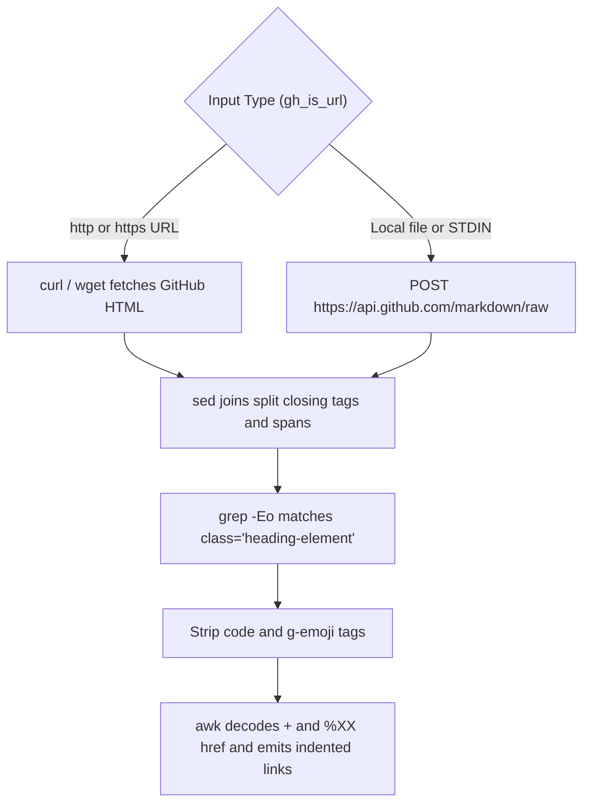

# GitHub API Parsing and Option Design

Replicating GitHub's CommonMark slugification rules in pure Bash (`sed`/`awk`) breaks easily on Unicode titles, duplicate headings, C++ symbols, code spans, and Setext underlines. Instead of re-implementing GitHub's slugifier, `gh-md-toc` renders raw Markdown through GitHub's canonical HTML pipeline and extracts the emitted anchors.

## Rendering and Anchor Extraction Flow

Using GitHub's server-side HTML renderer guarantees exact anchor parity with GitHub pages (`#c-vs-c`, CJK headings, backticks inside titles), at the cost of requiring HTTPS connectivity and a `GH_TOC_TOKEN` when exceeding anonymous API rate limits.

## Sequential Flag Parsing and File Safety

Inside `gh_toc_app`, option handling checks `$1` sequentially rather than looping with `while getopts` or `case`. Consequently, options supplied out of order (for example `--insert --indent 2`) are not consumed before the file loop begins and are passed to `gh_toc` as filenames. Ordering flags as `--indent`, `--insert`, `--no-backup`, `--hide-footer`, `--skip-header` matches the implementation directly.

For local edits, `gh-md-toc` writes backup `.orig.<timestamp>` and `.toc.<timestamp>` artifacts by default so users can inspect or revert `sed` replacements unless `--no-backup` is explicitly selected. Additionally, `gh_toc_md2html` preserves the `curl` return code before removing temporary `--skip-header` (`~~`) files so network failures never appear as empty TOC output.

## Related Documentation

- Exact flag positions and exit conditions: [CLI Options, Tokens, and Markers](../03-reference/01-cli-options-tokens-and-markers.md)
- Token configuration and CI automation: [Insert and Automate TOC with Tokens](../02-how-to-guides/01-insert-and-automate-toc-with-tokens.md)
